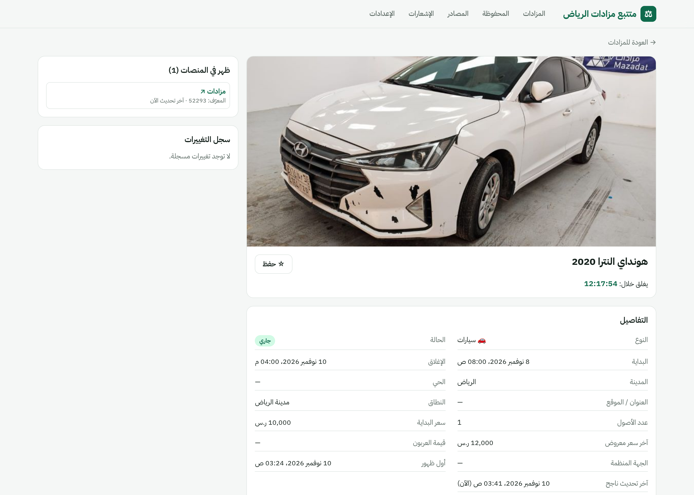
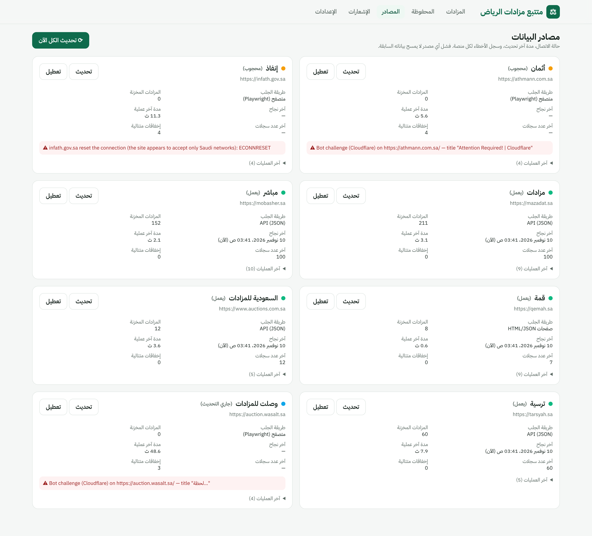
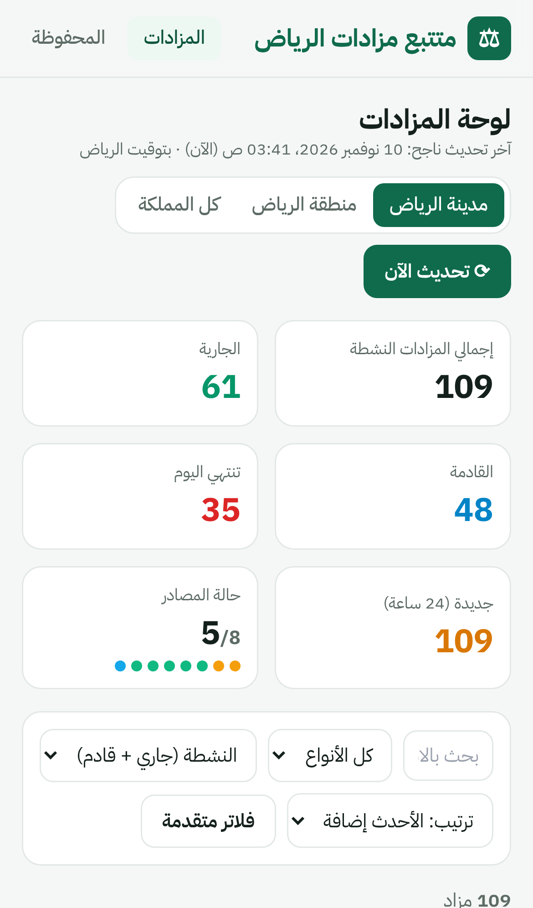

# Riyadh Auction Tracker — متتبع مزادات الرياض

تطبيق ويب يجمع المزادات من منصات المزادات السعودية، يوحّد بياناتها، يزيل التكرار بينها، ويعرضها في لوحة عربية (RTL) مع تركيز افتراضي على **مدينة الرياض**.

> **لا توجد أي بيانات تجريبية.** كل ما يظهر في الواجهة مجلوب من المنصات نفسها. الحقول غير المتوفرة في المصدر تُترك فارغة (—) ولا تُخمَّن.

## لقطات من التطبيق (بيانات حقيقية)

**لوحة المزادات — مدينة الرياض**


**صفحة المزاد**


**حالة المصادر وأخطاؤها**


**على الجوال**



---

## حالة المصادر (تم فحصها فعلياً في 10 نوفمبر 2026)

| المنصة | الحالة | طريقة الجلب | ما يتم استخراجه |
|---|---|---|---|
| **مباشر** `mobasher.sa` | ✅ يعمل | JSON API: `discovery-api.prod.mobasher.sa/api/v1/discovery/auctions` (cursor) | الاسم، النوع، المدن والمناطق والأحياء، البداية/النهاية (UTC)، الحالة، عدد الأصول، آخر سعر، صورة، الجهة البائعة |
| **السعودية للمزادات** `auctions.com.sa` | ✅ يعمل | JSON API (Odoo): `/en_US/api/get_auction_filter` | الاسم، التصنيف، المنطقة/المدينة/الأحياء، البداية/النهاية، الحالة، عدد المنتجات، صورة، الجهة المنفّذة |
| **مزادات** `mazadat.sa` | ✅ يعمل | JSON API: `POST api.mazadat.sa/api/v2/search` | كل سجل = أصل (مركبة غالباً): سعر البداية، أعلى مزايدة، المدينة، الإحداثيات، صورة، البداية/النهاية |
| **ترسية** `tarsyah.sa` (`tarsyah.com` يحوّل إليه) | ✅ يعمل | JSON API: `admin.tarsyah.sa/api/v1/auctions` | الاسم، النوع، الحالة، التواريخ، عدد الأصناف، صورة. **لا يوجد حقل مدينة** — الموقع يُستخرج فقط إن ورد في نص المزاد نفسه |
| **قمة** `qemah.sa` | ✅ يعمل | JSON من صفحات Laravel: `/auctions/{live,upcoming,finished}` | الاسم، التصنيف (سيارات/لوحات)، تاريخ ووقت البدء، عدد المعروضات. **لا يوجد وقت انتهاء ولا موقع** في المصدر |
| **إنفاذ** `infath.gov.sa` | ⛔ محجوب | Playwright + محلّل JSON عام | الخادم يقطع الاتصال (`ECONNRESET`) من شبكات خارج السعودية — يُتوقّع أن يعمل عند التشغيل من شبكة سعودية |
| **وصلت** `auction.wasalt.sa` | ⛔ محجوب | Playwright + محلّل JSON عام | تحدي Cloudflare ("لحظة…") يمنع المتصفح الآلي |
| **أثمان** `athmann.com.sa` | ⛔ محجوب | Playwright + محلّل JSON عام | Cloudflare "Attention Required" |

المصادر المحجوبة لها Connectors مستقلة تعمل عبر Playwright وتلتقط استجابات JSON الخاصة بالموقع وتحوّلها بمحلّل عام (`src/connectors/heuristic.ts`). عند ظهور التحدي يُسجَّل الخطأ كـ **محجوب** في صفحة المصادر ولا يُعاد المحاولة بشكل مكثف، وتستمر بقية المصادر. لأن مخطط بياناتها لم يكن قابلاً للفحص من بيئة التطوير، قد تحتاج دالة الربط إلى تعديل بسيط بعد أول تشغيل ناجح من شبكة سعودية (السجلات تُظهر أسماء الحقول الملتقطة).

نتيجة أول تشغيل حقيقي (10 نوفمبر 2026): 236 مزاداً من 5 منصات، منها 177 نشطاً (جاري أو قادم)؛ 109 من النشطة في مدينة الرياض. (عند تشغيل الـ worker تُضاف أيضاً المزادات المنتهية مؤخراً.)

---

## التشغيل السريع (Docker Compose)

```bash
cp .env.example .env
docker compose up --build
# الواجهة: http://localhost:3000
```

الخدمات: `postgres` · `redis` · `web` (Next.js، يطبّق الـ migrations عند البدء) · `worker` (BullMQ + Scheduler + Playwright Chromium).

## التشغيل المحلي بدون Docker

المتطلبات: Node 22، PostgreSQL 16، Redis 7.

```bash
npm install
cp .env.example .env              # عدّل DATABASE_URL و REDIS_URL
npx prisma migrate deploy         # إنشاء الجداول
npm run scrape                    # (اختياري) سحب فوري لكل المصادر بدون Redis
npm run worker                    # في طرفية: المجدول والطابور
npm run dev                       # في طرفية أخرى: الواجهة على :3000
```

أوامر أخرى:

```bash
npm test                          # اختبارات الاستخراج والتوحيد ومنع التكرار (fixtures حقيقية)
npm run typecheck
npm run scrape -- mobasher qemah  # سحب مصادر محددة
MODE=ended npm run scrape         # سحب المزادات المنتهية مؤخراً
```

> خلف بروكسي HTTP؟ شغّل Node بـ `NODE_USE_ENV_PROXY=1` (Node ≥ 22.21) ليستخدم `fetch` متغير `HTTPS_PROXY`، و`PLAYWRIGHT_PROXY` للمتصفح.

---

## البنية

```
src/
  connectors/          ← Connector مستقل لكل منصة
    types.ts           ← واجهة Connector و RawAuction و BlockedError
    index.ts           ← السجل: أضف مصدراً جديداً هنا (سطر واحد)
    mobasher.ts  saudia-auctions.ts  mazadat.ts  tarsyah.ts  qemah.ts
    protected.ts       ← إنفاذ / وصلت / أثمان (Playwright)
    browser.ts         ← تحميل الصفحة، كشف التحدي، التقاط JSON
    heuristic.ts       ← محلّل عام لاستجابات JSON مجهولة المخطط
  lib/
    normalize.ts       ← توحيد النص العربي، التصنيفات، الحالة، الأسعار
    geo.ts             ← تصنيف الموقع: مدينة الرياض / منطقة الرياض / أخرى
    dedup.ts           ← محرك منع التكرار
    ingest.ts          ← حفظ القوائم، الدمج، سجل التغييرات، الأحداث
    scrape.ts          ← تشغيل connector مع قفل لكل مصدر وتسجيل العملية
    notify.ts          ← قواعد الإشعارات + القنوات (داخل التطبيق، Telegram)
    queue.ts           ← BullMQ
    query.ts           ← الفلاتر والترتيب للـ API
  worker/index.ts      ← Worker + Scheduler
  app/                 ← Next.js (الواجهة + /api)
prisma/schema.prisma
tests/                 ← vitest + fixtures حقيقية من كل منصة
```

### إضافة مصدر جديد

1. أنشئ `src/connectors/<name>.ts` يصدّر كائناً من نوع `Connector`:
   ```ts
   export const myPlatform: Connector = {
     id: 'my-platform', name: 'منصتي', baseUrl: 'https://…', method: 'api',
     modes: ['discovery', 'manual'],          // الأوضاع التي يدعمها بطلب أرخص
     async fetchAuctions({ mode, log }) { return [/* RawAuction */]; },
   };
   ```
2. أضفه إلى المصفوفة في `src/connectors/index.ts`.

لا حاجة لأي تعديل آخر: سيُنشأ صف المصدر تلقائياً، ويظهر في صفحة المصادر، ويدخل الجدولة.

### نموذج البيانات

- **Auction**: المزاد الموحّد (بعد إزالة التكرار) — هو ما تعرضه الواجهة.
- **Listing**: ظهور المزاد في منصة واحدة (`sourceId + externalId` فريد). مزاد واحد قد يملك عدة Listings → روابط كل المنصات.
- **Asset**: أصل داخل القائمة بمعرّف مستقل، حتى لا تُدمج أصول/مزادات مختلفة بالخطأ.
- **AuctionChange**: سجل تغيّر المواعيد والأسعار والحالة.
- **Source / ScrapeRun**: حالة كل مصدر وسجل كل عملية سحب (المدة، العدد، الخطأ، رقم المحاولة).
- **NotificationRule / Notification / SavedAuction / Setting**.

كل الأوقات تُخزَّن UTC وتُعرض بتوقيت `Asia/Riyadh`.

### التصنيف الجغرافي

يعتمد على موقع الأصل المعروض (مدن/مناطق/أحياء المزاد وأصوله، والإحداثيات إن وُجدت)، لا على موقع الشركة المنظمة:

- **مدينة الرياض**: مدينة "الرياض"/Riyadh، أو حي معروف من أحياء الرياض ضمن منطقة الرياض، أو إحداثيات داخل النطاق العمراني.
- **منطقة الرياض**: محافظات المنطقة (الخرج، الدرعية، المزاحمية، الدوادمي، المجمعة، الزلفي…).
- **متعدد المواقع**: عندما يشمل المزاد أكثر من مدينة؛ يظهر في فلتر الرياض إن كان أحد أصوله فيها، مع شارة "متعدد المواقع" وقائمة المدن.

### منع التكرار (`src/lib/dedup.ts`)

لكل قائمة جديدة يبحث المحرك عن مزاد موحّد قريب زمنياً (±2 يوم) من **منصة أخرى** ويحسب درجة تطابق من:
معرّفات مرجعية مشتركة (تطابق فوري) · تشابه العنوان بعد التوحيد · الجهة المنظمة · قرب تاريخي البداية والنهاية (±3 ساعات) · عدد الأصول · المدن.
قواعد صارمة تمنع الدمج الخاطئ: قائمتان من نفس المنصة لا تُدمجان أبداً؛ اختلاف التاريخ المعروف أو المدينة أو التصنيف يمنع الدمج؛ العناوين العامة القصيرة ("مزاد سيارات") تتطلب تطابق الجهة؛ بدون أي تاريخ لا يتم الدمج.

### الجدولة والتحديث (`src/worker/index.ts`)

| المهمة | الافتراضي |
|---|---|
| اكتشاف المزادات الجديدة | كل 30 دقيقة |
| المزادات الجارية | كل 10 دقائق |
| تغلق خلال أقل من ساعة | كل 3 دقائق (فقط للمصادر التي لديها مزادات كذلك وتدعم الوضع) |
| القادمة | كل 60 دقيقة |
| المنتهية | كل 24 ساعة |
| تحديث الواجهة من قاعدة البيانات | كل 60 ثانية |

- قابلة للتعديل من **الإعدادات**؛ الـ worker يقرأها كل 30 ثانية.
- **Queue (BullMQ)** بمعرّف مهمة `source__mode` فلا تُضاف نفس المهمة مرتين، و**قفل Redis لكل مصدر** يمنع سحبين متزامنين لنفس المنصة.
- **Retry**: 3 محاولات بـ exponential backoff (20ث، 40ث…) على مستوى المهمة + إعادة محاولة HTTP للأخطاء المؤقتة (شبكة، 429، 5xx). أخطاء الحجب لا يعاد تكرارها.
- فشل أي مصدر **لا يمسح** بياناته السابقة؛ يُسجَّل الخطأ ويستمر الباقي.
- زر **"تحديث الآن"** (عام أو لكل مصدر) يضيف مهام `manual` بأولوية أعلى.
- مسح دوري يحدّث حالة المزادات حسب التواريخ، وفحص كل دقيقة للمزادات المحفوظة القريبة من الإغلاق.
- عدّاد تنازلي في الواجهة يعتمد على وقت الإغلاق المخزّن (مؤقّت واحد مشترك، دون استدعاء المصدر).

### الإشعارات

داخل التطبيق (مع عدّاد غير مقروء)، والقواعد قابلة للتفعيل/التعديل من صفحة الإشعارات:
مزاد جديد في الرياض (مع اختيار النطاق) · مزاد جديد من نوع محدد · اقتراب انتهاء مزاد محفوظ (عدد الدقائق) · تغيير موعد · تغيير السعر المعروض (افتراضياً للمحفوظة فقط).
لا تُرسل إشعارات "جديد" في أول مزامنة لأي مصدر لتجنب الإغراق.
**Telegram**: قناة جاهزة في `notify.ts` — ضع `TELEGRAM_BOT_TOKEN` في `.env` وفعّلها مع Chat ID من الإعدادات، ثم فعّل "إرسال إلى Telegram" لكل قاعدة. يمكن إضافة قنوات أخرى بتنفيذ واجهة `Channel`.

### API

| Endpoint | الوصف |
|---|---|
| `GET /api/auctions` | `geo=riyadh_city\|riyadh_region\|all`, `category`, `source`, `status` (`live,upcoming,ended,all`)، `city`, `district`, `organizer`, `q`, `startFrom/startTo/endFrom/endTo`, `minPrice/maxPrice`, `sort=newest\|ending\|starting\|price_desc\|price_asc`, `page`, `pageSize`, `saved=1`, `endingToday=1` |
| `GET /api/auctions/:id` | التفاصيل + روابط كل المنصات + الأصول + سجل التغييرات |
| `GET /api/stats?geo=` | الإحصاءات وحالة المصادر |
| `GET /api/facets?geo=` | قيم الفلاتر (المدن، الأحياء، الجهات، المنصات) |
| `GET /api/sources` · `PATCH /api/sources` | حالة المصادر وآخر العمليات · تفعيل/تعطيل |
| `POST /api/refresh` | تحديث يدوي `{sourceId?}` |
| `GET/PUT /api/settings` | فترات التحديث والنطاق الافتراضي وTelegram |
| `GET/POST /api/notifications` · `GET/PUT /api/rules` | الإشعارات وقواعدها |
| `POST/DELETE /api/saved/:id` | حفظ/إزالة مزاد |

### السجلات

سجلات JSON منظمة عبر `pino` (`LOG_PRETTY=1` للقراءة البشرية). كل عملية سحب تسجّل المصدر والوضع والعدد والمدة والخطأ، وتُحفظ في جدول `ScrapeRun` وتظهر في صفحة المصادر.

### الخصوصية

لا يُخزَّن أي بيانات شخصية: مثلاً قوائم "قمة" تحتوي مسارات مستندات ملاك اللوحات، ويقرأ الـ connector حقول المزاد فقط. الحقل `raw` يحفظ قائمة بيضاء من الحقول للتشخيص ولا يُرسل للمتصفح.

### قيود معروفة

- إنفاذ ووصلت وأثمان محجوبة من بيئة التطوير (انظر الجدول) — تحتاج تشغيلاً من شبكة سعودية/عنوان IP مقبول، أو اتفاق وصول رسمي.
- قيمة العربون غير متاحة في القوائم العامة للمنصات العاملة حالياً، لذلك تظهر فارغة.
- تفاصيل الأصول داخل مزادات مباشر تُحمَّل عبر خادم GraphQL يتطلب جلسة؛ يتم حفظ عدد الأصول فقط.
- التطبيق أحادي المستخدم (بدون تسجيل دخول) — المحفوظات والإشعارات مشتركة لكل من يفتح اللوحة.
