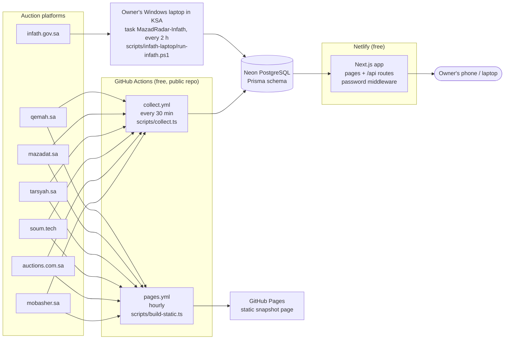
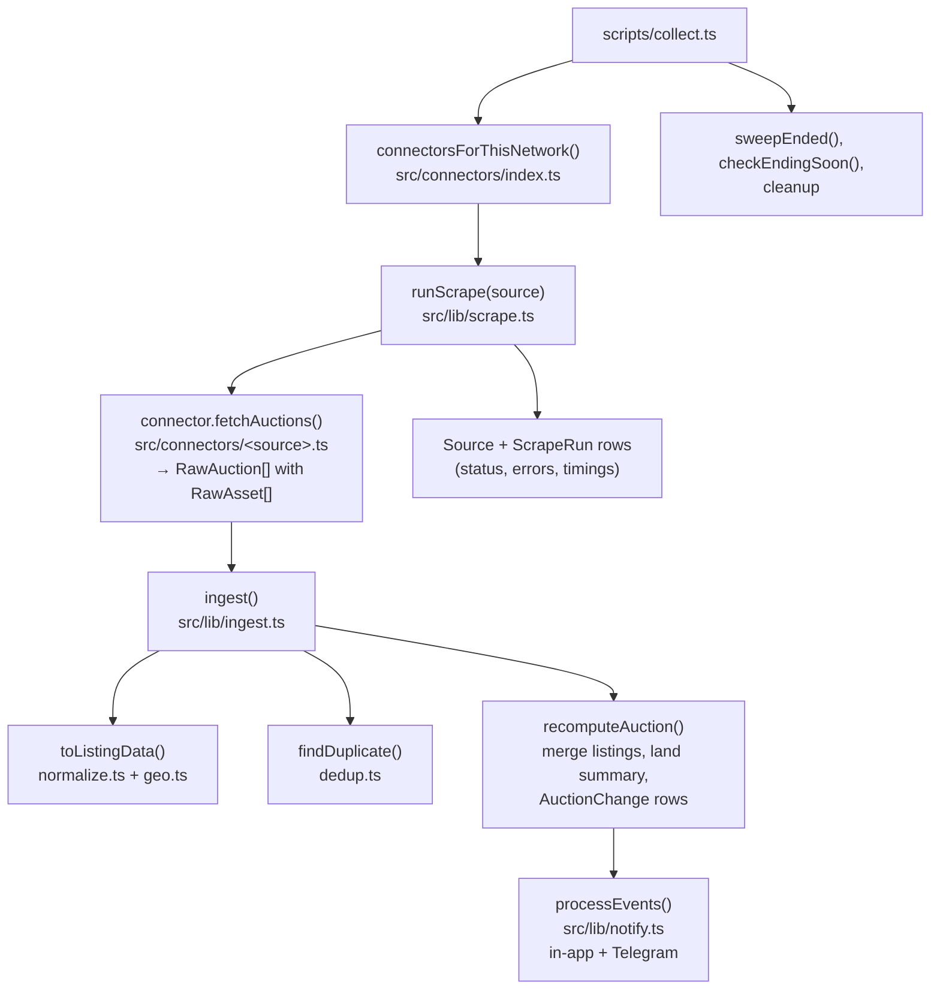
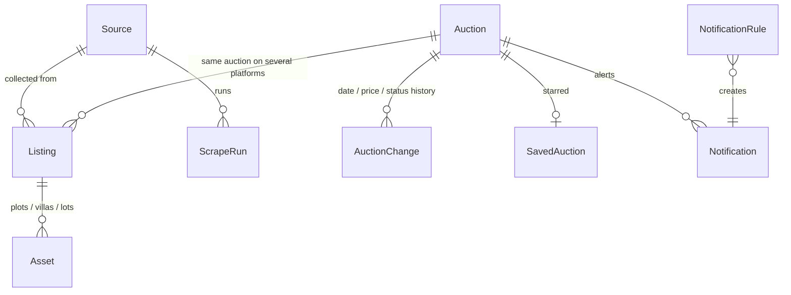

# Mazad Radar — code map

How the code is organised, for a developer picking up the project. See also `docs/PROJECT_HISTORY.md` (history, decisions, live setup) and `README.md` (sources, setup steps).

## 1. The big picture

Infath only answers Saudi networks, so it is collected from the laptop (same code, `SAUDI_NETWORK=1`). Wasalt and Athmann are behind Cloudflare bot challenges and are **not** collected (never bypass).

## 2. Inside one collection run

## 3. Folders

| Folder / file | What it is |
|---|---|
| `src/connectors/` | **One file per platform.** Each exports a `Connector` (`types.ts`) whose `fetchAuctions()` returns normalised `RawAuction`s (with `RawAsset`s). Registry: `index.ts`. |
| `src/connectors/types.ts` | `Connector`, `RawAuction`, `RawAsset`, `BlockedError`, `saudiOnly` flag. |
| `src/connectors/{mobasher,saudia-auctions,soum,tarsyah,mazadat,qemah}.ts` | Working sources (JSON APIs / SvelteKit data / HTML-JSON). |
| `src/connectors/infath.ts` | Infath HTML (Cheerio), `saudiOnly`. |
| `src/connectors/{protected,browser,heuristic}.ts` | Playwright-based connectors for Wasalt/Athmann — they only detect the Cloudflare challenge and report "blocked". |
| `src/lib/ingest.ts` | Core pipeline: listings → canonical auctions, assets, land summary, change history, events. Parallel (`INGEST_CONCURRENCY`). |
| `src/lib/normalize.ts` | Arabic text normalisation, categories, statuses, money, property types (`land`, `villa`…), usages. |
| `src/lib/geo.ts` | Riyadh city / Riyadh region / other classification (cities, towns, districts, coordinates). |
| `src/lib/dedup.ts` | Cross-platform duplicate detection (pure, unit-tested). |
| `src/lib/notify.ts` | Notification rules + channels (in-app, Telegram). |
| `src/lib/scrape.ts` | Runs one connector, records `ScrapeRun`, optional Redis lock. |
| `src/lib/query.ts` | Filters/sorting for `/api/auctions`. |
| `src/lib/{auth.ts, ../middleware.ts}` | Site password (`APP_PASSWORD`) — HMAC cookie, login redirect. |
| `src/lib/scheduler-mode.ts` | `worker` (Redis/BullMQ) vs `github` (free hosting) mode; "refresh now" via GitHub workflow dispatch. |
| `src/lib/{db,http,time,settings,logger,serialize,queue}.ts` | Prisma client (Neon pooler handling), fetch with retry/backoff, Riyadh time helpers, settings, pino logs, JSON serialisation, BullMQ queue. |
| `src/worker/index.ts` | Long-running BullMQ worker + scheduler (only for Docker/paid hosting; not used on the free setup). |
| `src/app/` | Next.js App Router: pages and `api/` routes (below). |
| `src/components/` | `Dashboard`, `AuctionCard`, `Countdown`, `MapView` (Leaflet), `Nav`, `format`. |
| `src/lib/deals.ts`, `src/data/`, `scripts/deals/` | Ministry of Justice sales → per-district Riyadh summaries for the map (`build-deals.ts`), district centroids + simplified boundaries (`district-centroids.ts`). |
| `prisma/` | `schema.prisma` + migrations. |
| `scripts/` | `collect.ts` (GitHub collector), `scrape-once.ts` (local test), `build-static.ts` (GitHub Pages page), `start-all.sh` (Render), `infath-laptop/` (Windows setup + runner). |
| `static/template.html` | Single-file page used by the GitHub Pages build. |
| `tests/` | Vitest: connectors (real trimmed fixtures), normalisation/geo, dedup, land summary, Infath, Soum. |
| `.github/workflows/` | `collect.yml` (every 30 min → Neon), `pages.yml` (hourly static page). |
| Hosting configs | `netlify.toml` (live), `render.yaml` + `Dockerfile.render` (paid, unused), `Dockerfile` + `docker-compose.yml` (local/VPS). |

## 4. Database (Prisma)

- **Auction** = canonical (deduplicated) auction shown in the UI; merged fields + `geoScope`, `hasRiyadhCity`, `hasLand`, `landCount`, `landAreaSqm`, `propertyTypes`, `usages`.
- **Listing** = the auction as it appears on one platform (`sourceId + externalId` unique), with its URL.
- **Asset** = one item inside a listing: `propertyType`, `usage`, `areaSqm`, prices, `deposit`, `city`/`district`, `latitude`/`longitude`, own `geoScope`.
- **Setting** (key `app`), **SavedAuction**, **NotificationRule**, **Notification**, **Source**, **ScrapeRun**.
- All times stored in UTC; UI shows Asia/Riyadh.

## 5. Pages and API

| Page | File | Uses API |
|---|---|---|
| `/` dashboard (land focus by default) | `components/Dashboard.tsx` | `/api/auctions`, `/api/stats`, `/api/facets`, `/api/refresh` |
| `/properties` every asset | `app/properties/page.tsx` | `/api/assets` |
| `/map` map of assets + MoJ deals layer | `components/MapView.tsx` | `/api/map`, `src/data/riyadh-deals.json` (static) |
| `/auctions/[id]` details + plots + history | `app/auctions/[id]/page.tsx` | `/api/auctions/[id]`, `/api/saved/[id]` |
| `/saved` | `components/Dashboard.tsx` (savedOnly) | same as dashboard |
| `/sources` platform health | `app/sources/page.tsx` | `/api/sources`, `/api/refresh` |
| `/notifications` alerts + rules | `app/notifications/page.tsx` | `/api/notifications`, `/api/rules` |
| `/settings` | `app/settings/page.tsx` | `/api/settings`, `/api/logout` |
| `/login` | `app/login/page.tsx` | `/api/login` |

`/api/health` is public (used by hosting health checks); everything else requires the password cookie when `APP_PASSWORD` is set.

## 6. Adding a platform

1. Create `src/connectors/<name>.ts` exporting a `Connector` (`id`, `name`, `baseUrl`, `method`, `modes`, `fetchAuctions`). Map only fields that exist — never invent values; don't store personal/contact data.
2. Add it to the `connectors` array in `src/connectors/index.ts` (set `saudiOnly: true` if it only answers Saudi networks).
3. Save a trimmed real response under `tests/fixtures/` and add a test.
4. Allow the host in the cloud environment if developing there; push. GitHub's collector picks it up automatically.
